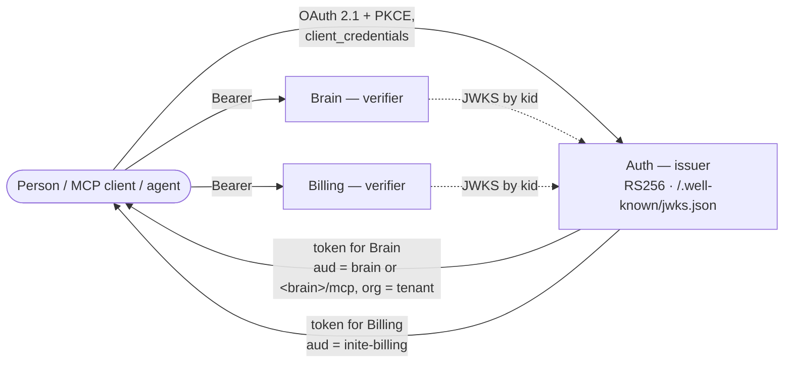

# INITE Triad

[](https://github.com/inite-ai/inite-triad/actions/workflows/e2e.yml)


[](LICENSE)

Run three self-hosted services as one platform with one compose file:
sign-in, billing and long-term memory for AI agents.

| Service | Repo | Role |
|---|---|---|
| **Auth** | [inite-ai/inite-auth-service](https://github.com/inite-ai/inite-auth-service) | OAuth 2.1 / OpenID Connect server: passkeys, dynamic client registration, RFC 8707 resource indicators, MCP authorization. The **issuer** of every token. |
| **Brain** | [inite-ai/inite-brain-service](https://github.com/inite-ai/inite-brain-service) | Bitemporal knowledge-graph memory for AI agents over MCP and REST, on SurrealDB. Verifies tokens; the tenant comes from the `org` claim. |
| **Billing** | [inite-ai/inite-billing-service](https://github.com/inite-ai/inite-billing-service) | Payment-rail-agnostic billing: subscriptions, credits, checkout, agent wallets, MCP. Verifies tokens; the customer is the token's `sub`. |



One issuer, single-audience tokens: a token minted for Brain is refused by
Billing and the other way round. The rules for `iss`, `aud`, `sub`, `org`,
scopes, key rotation and upgrades are the
**[Triad token & compatibility contract](https://github.com/inite-ai/inite-ecosystem/blob/main/docs/triad-compatibility.md)**.
This repo wires the services exactly as §8 of it says.

## Quick start

Requires Docker with Compose v2, `curl` and `jq`.

```bash
git clone https://github.com/inite-ai/inite-triad && cd inite-triad
cp .env.example .env               # works as-is on localhost
docker compose up -d --wait        # Postgres, Redis, SurrealDB, Auth, Brain, Billing
./bootstrap.sh                     # first admin + OAuth clients → .secrets/triad.env
./verify.sh                        # real tokens from Auth, used on Brain and Billing
```

What you get, bound to 127.0.0.1:

| | URL |
|---|---|
| Auth (issuer, OIDC discovery) | http://localhost:3002/.well-known/openid-configuration |
| Billing | http://localhost:3003 |
| Brain (REST, MCP at `/mcp`) | http://localhost:3004 |

`bootstrap.sh` creates the first Auth administrator and registers three
OAuth clients: `brain-service` (machine-to-machine, `aud=brain`, tenant
`co_triad`), `inite-billing` (the billing frontend) and `triad-quickstart` (a
user client that asks for Brain's RFC 8707 resource, the way an MCP connector
does). It is idempotent.

`verify.sh` checks:

1. every health and readiness endpoint, and that all three agree on one issuer;
2. a machine token (`client_credentials`, `aud=brain`) lists Brain's MCP tools;
3. a person token (auth code + PKCE, `resource=<brain>/mcp`) works on Brain,
   and still works after a refresh: the audience survives it;
4. a billing token reads `GET /v1/credits/me`;
5. each token is refused by the service it was not minted for.

Brain needs a real `OPENAI_API_KEY` in `.env` to write memory (extraction,
embeddings). Reads, and everything `verify.sh` does, work with the placeholder.

## Tested on

The [e2e workflow](.github/workflows/e2e.yml) runs the quick start above —
`up`, `bootstrap.sh`, `verify.sh` — from the released images on every push and
weekly, on GitHub's native **amd64** (`ubuntu-24.04`) and **arm64**
(`ubuntu-24.04-arm`) runners. Each run's summary records the time until all
services are healthy and the memory every container uses at rest.

First recorded run (2026-10-16), after `verify.sh`:

| | amd64 | arm64 |
|---|---|---|
| `up` until all healthy | 71 s | 66 s |
| Brain (local NER / NLI / reranker models loaded) | 3.7 GB | 3.7 GB |
| Auth + Billing + Postgres + Redis + SurrealDB | 0.8 GB | 0.9 GB |

Plan for about 5 GB of RAM; Brain is most of it.

## Deploy on a server

1. Point three hostnames at the server, for example `auth.example.com`,
   `brain.example.com`, `billing.example.com`.
2. In `.env`: set `AUTH_PUBLIC_URL`, `BRAIN_PUBLIC_URL`, `BILLING_PUBLIC_URL`
   to those `https://` URLs (`AUTH_PUBLIC_URL` becomes the issuer in every
   token — choose it once), set `AUTH_RP_ID` to the parent domain for
   passkeys, and replace every value marked `[secret]`
   (`openssl rand -base64 32`).
3. Keep the services on 127.0.0.1 and put a TLS proxy in front. With Caddy:

   ```caddy
   auth.example.com {
     reverse_proxy 127.0.0.1:3002
   }
   brain.example.com {
     reverse_proxy 127.0.0.1:3004
   }
   billing.example.com {
     reverse_proxy 127.0.0.1:3003
   }
   ```

4. `docker compose up -d --wait && ./bootstrap.sh && ./verify.sh`.

### ARM servers (Oracle Cloud Always Free and others)

Every image is published for `linux/arm64`, so the stack runs natively on
Ampere and Graviton machines — for example Oracle Cloud's Always Free
`VM.Standard.A1.Flex` (up to 4 OCPU / 24 GB). Install Docker
(`curl -fsSL https://get.docker.com | sh`), then follow the steps above.
arm64 is verified on GitHub's arm64 runners (see *Tested on*); a run on OCI
itself has not been recorded yet — reports welcome in Issues.

## Upgrades

Versions are pinned in `.env` (`AUTH_VERSION`, `BRAIN_VERSION`,
`BILLING_VERSION`). Upgrade one service at a time in the order
**Auth → Brain → Billing**:

```bash
# edit the version in .env, then
docker compose pull auth && docker compose up -d --wait auth
```

Each image migrates its own database at boot. Auth goes first because it only
starts emitting what released verifiers already accept; the exception — a new
issuer URL, signing key or audience — goes to the verifiers first. Which
versions work together:
[contract §9](https://github.com/inite-ai/inite-ecosystem/blob/main/docs/triad-compatibility.md#9-version-compatibility-matrix).

## License

This deployment kit is MIT. The services it runs are AGPL-3.0 — see each
service's repository. If the Triad is useful to you, a star on the services
you run helps the project.
